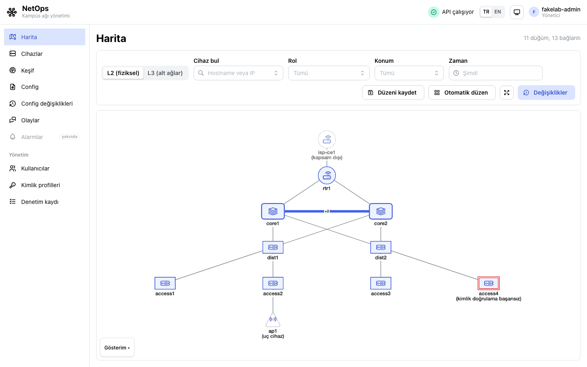
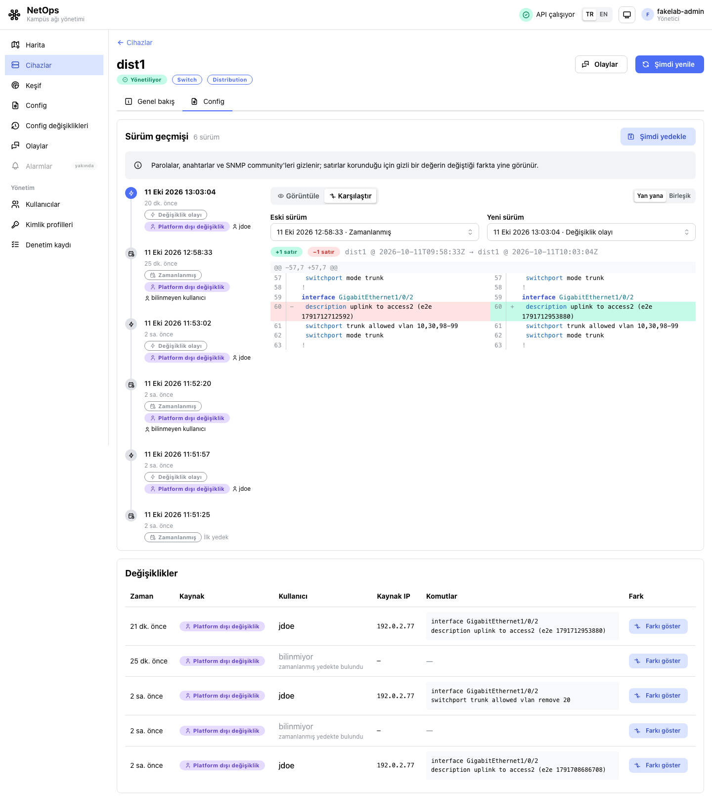
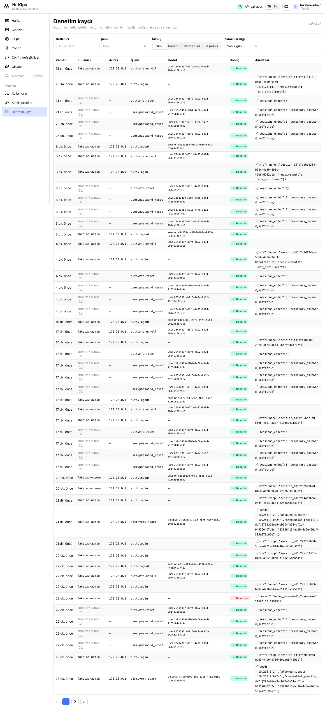

# NetOps Platform

Centralized network management, monitoring and fault-diagnosis platform for Cisco
IOS/IOS-XE campus networks. Graduation project.

Design reference: the project proposal,
[docs/proposal/proposal-v2.pdf](docs/proposal/proposal-v2.pdf) (in Turkish).

> Status: discovery (M1), inventory collection (M2) and configuration management (M4:
> backups in a local Git repository, redacted diffs, changes made outside the platform
> detected from syslog) work against a fake lab, with UI screens for the topology map,
> devices, discovery, configurations, changes and syslog events. Every page and API call
> needs a sign-in (M7: passwords and TOTP, roles, an append-only audit log, user and
> credential administration). Monitoring and alarms, central configuration and diagnosis
> come next. The stack runs end to end (UI → nginx → API → TimescaleDB and Redis, plus
> Celery workers and the syslog receiver).



## Quickstart

Prerequisites: Docker with Compose v2, GNU Make, OpenSSL (for `make up` to generate a
database password). For local development also [uv](https://docs.astral.sh/uv/) and
Node.js 24 (≥ 22.12 works).

```bash
make up         # creates deploy/.env on first run, builds, migrates the database, starts all services
```

`deploy/.env` gets a random database password, a random `CREDENTIALS_KEY`, which encrypts
the device credentials and MFA secrets stored in the database (keep a copy of it outside
the database backups, [ADR-0004](docs/adr/0004-credentials-and-device-access.md)), and a
random `AUTH_SIGNING_KEY`, which signs the access tokens.

There is no default account. Create the first admin on the server; it asks for a username
and a password (at least 12 characters, not a common one) without echoing them:

```bash
docker compose -f deploy/docker-compose.yml exec api netops users create-admin
```

Then open:

- UI: <http://localhost:8080>; sign in, then set up MFA with an authenticator app (required
  for admins and operators) and keep the ten recovery codes
- API docs: <http://localhost:8080/api/docs>
- Health: `curl http://localhost:8080/api/health`
  → `{"status":"ok","version":"0.1.0","db":"ok","redis":"ok"}` (HTTP 503 if a dependency is down)

`make logs` follows the logs and `make down` stops everything (the database volume is
kept). Without Make: `cp deploy/.env.example deploy/.env`, set `POSTGRES_PASSWORD`, then
`cd deploy && docker compose up --build`.

TimescaleDB telemetry is turned off (`TIMESCALEDB_TELEMETRY=off`): the platform runs inside
an institution's network and must not send data out.

All ports are bound to `127.0.0.1`: web `8080`, api `8000`, PostgreSQL `5433`, Redis
`6379`, syslog `5514/udp`. Change them in `deploy/.env`.

## Development

```bash
make install    # backend venv (uv sync), frontend node_modules (npm ci), git pre-commit hooks
make lint       # ruff, mypy --strict, eslint, prettier, tsc
make test       # backend unit tests (no database, Redis or network needed)
make test-integration  # schema and query tests against the compose database (after `make up`)
```

Run parts of the stack outside Docker:

```bash
# Backend on the host, against the db and redis containers
docker compose -f deploy/docker-compose.yml up -d db redis
cp backend/.env.example backend/.env    # then copy POSTGRES_PASSWORD and the keys from deploy/.env
cd backend && uv run uvicorn netops.main:app --reload

# Frontend dev server with hot reload; proxies /api and /ws to localhost:8000
cd frontend && npm run dev
```

New migration: `cd backend && uv run alembic revision --autogenerate -m "add devices table"`.

## API contract and mock server

The REST API is defined contract-first: [docs/api/openapi.json](docs/api/openapi.json)
(browsable at <http://localhost:8080/api/docs> when the stack runs), conventions in
[ADR-0003](docs/adr/0003-api-conventions.md), live updates in
[docs/api/websocket.md](docs/api/websocket.md). Sign-in and sessions, users, credential
profiles, the audit log, devices, discovery runs, jobs, topology (with its layout and
changes) and the location list are implemented, as are configuration backups, versions,
diffs and changes and the event list; the other endpoints still answer
`501 Not Implemented`. Every endpoint except health, sign-in, MFA verification and token
refresh needs a bearer token and names the permission it requires
(`x-required-permission` in the contract).

After changing schemas or routers in `backend/src/netops/api/`, regenerate and commit the
document and the frontend types (CI fails if they are stale):

```bash
make openapi    # docs/api/openapi.json + frontend/src/api/schema.d.ts
```

To build UI screens before the backend implements them, run the frontend against a mock
server that answers every endpoint with the contract's example data (two terminals):

```bash
cd frontend && npm run mock       # Prism on http://127.0.0.1:4010
cd frontend && npm run dev:mock   # UI on http://localhost:5173, /api proxied to the mock
```

The mock enforces the declared security: it wants an `Authorization: Bearer <token>`
header but accepts any token. It answers the UI's token refresh with the contract's example,
so the UI opens signed in as the example operator. Other responses can be requested with a
`Prefer` header, e.g. `Prefer: code=404` or `Prefer: example=not_found` on
`/api/v1/hosts/locate`.

## User interface

<http://localhost:8080> after `make up` (Turkish by default; EN in the header switches the
language, the theme follows the system or the header menu). The menu shows what the user's
role may see, and buttons a role may not use (collect now, back up, start a discovery,
save the layout) are hidden:

- **Harita** (map): the topology by role, L2 (physical links, EtherChannels as one thick
  edge) or L3 (subnets, HSRP gateways); search, role/location filters, a time selector for
  the past state, saved layouts and the list of topology changes.
- **Cihazlar** (devices): inventory with search, filters and sorting; the detail page shows
  facts, interfaces, data freshness and "Şimdi yenile" (collect now).
- **Keşif** (discovery): start a discovery (seeds, allowed subnets, credential profiles) and
  follow its runs address by address.
- **Config**: every managed device's last backup, versions and recent changes made outside
  the platform; a device's **Config** tab shows the version timeline (time, trigger, user),
  the configuration with IOS highlighting (secrets redacted), the diff between any two
  versions (side by side or unified) and the change list.
- **Config değişiklikleri**: every detected change with the "Platform dışı değişiklik"
  badge, user, source address and commands; filter by device, origin, user and time.
- **Olaylar** (events): syslog from the devices, filtered by device, severity and mnemonic.
- **Profilim** (account menu): change the password, turn MFA on or off, see and end your
  sessions.
- **Yönetim** (admins only): **Kullanıcılar** (create users, change roles, deactivate,
  reset MFA or the password, unlock), **Kimlik profilleri** (credential profiles; secret
  fields are write-only) and **Denetim kaydı** (the audit log, filterable).

Screenshots (fake lab, light and dark) are in [docs/screenshots/](docs/screenshots/).
Frontend tests: `cd frontend && npm test` (Vitest) and `npm run e2e` (Playwright against the
Prism mock); with the fake lab running, `npm run e2e:fakelab` discovers it from the UI and
`npm run screenshots` refreshes the screenshots. Frontend decisions:
[ADR-0006](docs/adr/0006-frontend.md).

## Fake lab and discovery

A made-up campus of fake Cisco devices ([lab/fakelab/](lab/fakelab/README.md)) runs in
containers next to the stack, so discovery can be tried without real equipment:

```bash
make fakelab-up         # the stack plus one container per fake device (10.255.0.0/24)
make fakelab-seed       # two SSH credential profiles, created with the netops CLI
make fakelab-users      # UI users fakelab-admin, -operator, -viewer (password in deploy/.env)
make fakelab-discover   # discover from core1; prints what happened to every address
make fakelab-accuracy   # device/link precision and recall against topology.yaml
make fakelab-down       # stop everything; `make up` for the normal stack again
```

Configuration backups and the change simulator (`make fakelab-backup`, `make
fakelab-change DEVICE=dist1 SCENARIO=remove-vlan-from-trunk`, `make fakelab-reset`) are
described in [lab/fakelab/README.md](lab/fakelab/README.md).

Results are in the API (`GET /api/v1/devices`, `/api/v1/discovery/runs`) and in
`docker compose -f deploy/docker-compose.yml exec api netops devices list`. The operator CLI
(`netops --help` in the api container) also adds credential profiles for a real network
(`netops credentials add NAME --username USER` prompts for the password) and starts
discovery with your own seeds and subnets. Design: [ADR-0005](docs/adr/0005-discovery.md).

## Configuration management and syslog

Configurations are backed up nightly (`CONFIG_BACKUP_SCHEDULE`), after every change a
device reports over syslog, and on request (`netops configs backup`, or "Şimdi yedekle" on
a device's Config tab). Complete configurations stay in a local Git repository in the
`config-repo` volume, which is never pushed anywhere (back it up, encrypted); everything
the API and UI show is redacted. What devices need (logging host, archive logging, a
privilege 15 read account): [docs/device-prerequisites.md](docs/device-prerequisites.md).
Security model and decisions: [ADR-0007](docs/adr/0007-config-management.md).



## Users, roles and the audit log

Three roles: **viewer** reads everything except credentials, users and the audit log;
**operator** also starts discovery, collects and backs up devices and saves map layouts;
**admin** also manages users and credential profiles and reads the audit log. Admins and
operators must use MFA (TOTP; `AUTH_MFA_REQUIRED_ROLES`). Access tokens last 15 minutes and
are renewed through an HttpOnly cookie; a session ends after 12 hours without use, after 7
days at most, or when signed out. Accounts lock for a growing time after five failed
attempts; sign-in is also rate-limited per address. Sign-ins, failures, lockouts, every
change made through the platform and every refused request go to the audit log, which the
database keeps append-only. Further users are created in Kullanıcılar or with
`netops users create NAME --role operator` (a temporary password, to be changed at the
first sign-in); `netops users --help` lists the rest (set a password, reset MFA, unlock).
Decisions: [ADR-0008](docs/adr/0008-authentication.md).



## Repository layout

```
backend/    FastAPI app, Celery workers, Alembic migrations (package `netops`), fake lab (`netops_fakes`)
frontend/   React + TypeScript (Vite) single-page app
deploy/     docker-compose.yml, nginx config, .env.example
docs/       data model overview (data-model.md) and architecture decision records (adr/)
lab/        device output fixtures and the fake lab topology
tools/      evaluation scripts (discovery accuracy)
```

How we work (branches, pull requests, checks, what must never be committed):
[CONTRIBUTING.md](CONTRIBUTING.md). Module map and code conventions: [CLAUDE.md](CLAUDE.md).

## License

To be decided with the project advisor; no license file has been added yet.
